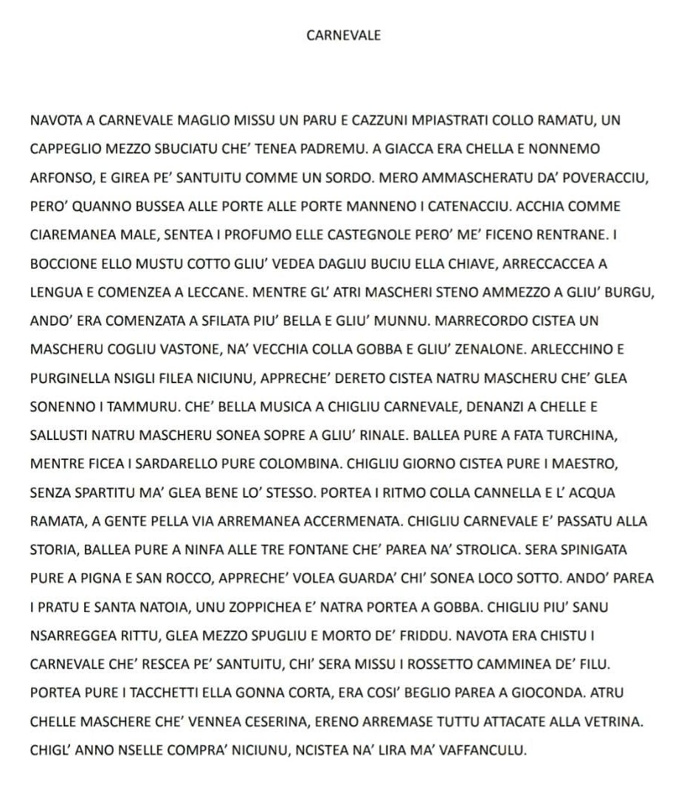

## The text in Sanvitese

## Explanation in English

The poem “Carnevale” (Carnival) recalls a Carnival in San Vito many years ago. The narrator dresses up as a poor man with whatever he finds at home: a pair of trousers stained with copper spray, his father's half-holed hat and his grandfather Alfonso's jacket. Dressed like this he wanders around the village and knocks on doors, but finds them bolted: he can smell the castagnole (the fried Carnival sweets) and, through the keyhole, he sees the big jar of mosto cotto (cooked grape must), so much that his mouth starts watering.

Meanwhile, in the middle of the village, the parade has begun, “the most beautiful in the world”. There is a mask with a stick, an old woman with a hump and an apron, and then Harlequin and Pulcinella, whom nobody watches, because behind them comes someone playing the drum and someone making music by beating on a chamber pot. The Blue Fairy and Columbine dance, and there is even a conductor leading without a score, keeping time with the lance of the copper sprayer. People stop open-mouthed, and it seems that even the village's fountains and saints lean out to watch, like the Nymph of the Tre Fontane, the Pigna and San Rocco.

The ending is ironic: some limp, some have a hump and some go about half-undressed and frozen, while whoever put on lipstick, heels and a short skirt struts along looking like the Mona Lisa. And the masks sold by Ceserina all stay hanging in the shop window: that year nobody buys them, because there was no money. With affection and a touch of nostalgia, the author describes a poor Carnival that was full of imagination, made with whatever there was at home and with the wish to be together.
