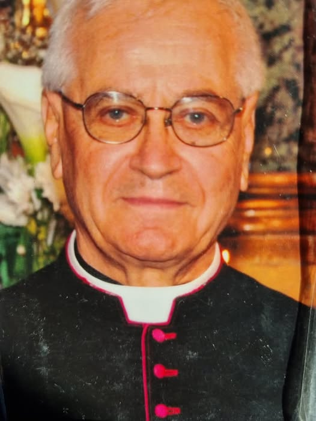
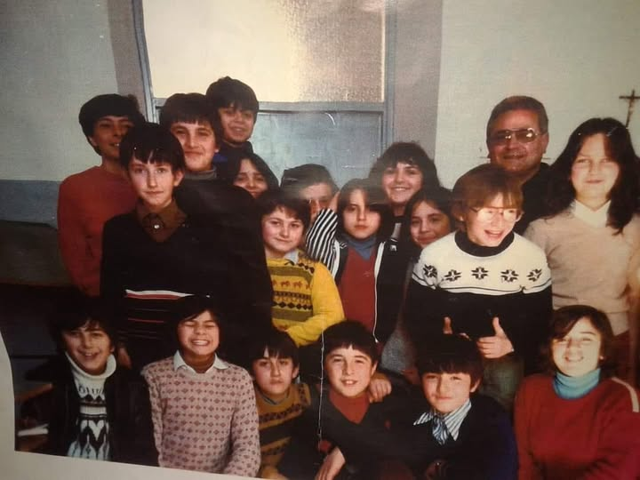
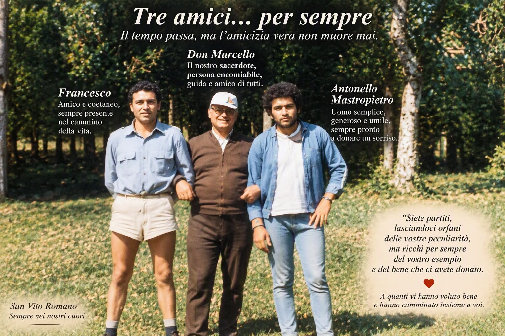
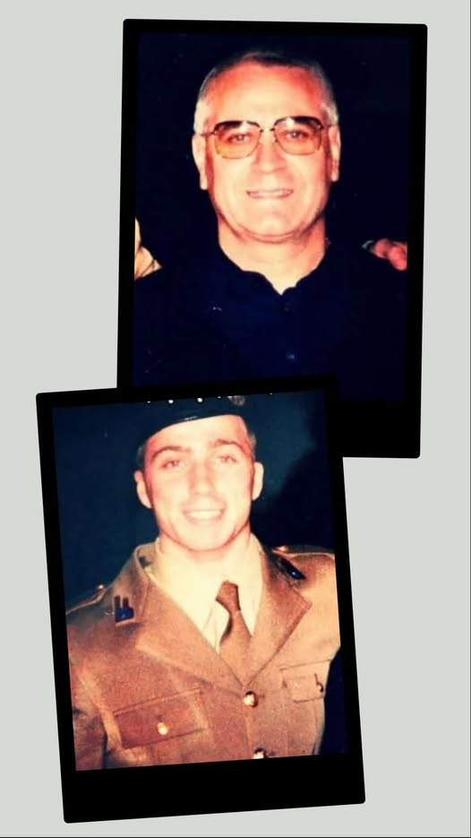

For anyone who grew up in San Vito Romano between the late Sixties and the late Nineties, "the priest of San Biagio" meant Don Marcello. Don Marcello Schiavella, originally from nearby Genazzano, came to the parish of San Biagio Martire in 1968 and stayed for thirty years, until October 1998: a very long time, during which he baptised, married, accompanied and above all helped raise whole generations of sanvitesi. "The legendary, much-loved Don Marcello, a symbol for many generations of young people", as the community has remembered him.

## His vocation

His path began very early: he entered the seminary in Palestrina in 1948, when he was just eleven, and went on to study at the Pontifical Leonine College in Anagni. Those who knew him as a young parish priest remember him in his cassock, with thick black hair and his ever-present glasses with their bold frames; and with his breviary, which he recited punctually every afternoon, without ever skipping one. Some also had him as a teacher at middle school.

## The three doors of Piazza San Biagio

His world was [Piazza San Biagio](/en/luoghi/piazza-san-biagio/). Below the church open three doors that the sanvitesi remember well: the first was the storeroom of Giuliano's shop, the second the recreation room, the third Don Marcello's study, with the library. For years an inscription on the wall called everyone to "peace, work and brotherhood"; it disappeared when, after he left, the building was renovated and repainted.

The parish rooms hosted catechism, tombola (Italian bingo) evenings with all the "nabballeri" kids from the nnabballe quarter and, above all, the cinema. Almost every Sunday Don Marcello screened a film: at the door sat Valeriano at his little table, tearing the tickets, and for 100 lire you could watch the show, kids, families and old folks all together. For the older ones it is still "the legendary cinema of Don Marcello and Valeriano", a sort of San Vito "Cinema Paradiso".

His study, on the other hand, was for many "a den full of serenity, culture and work". There Don Marcello built his wooden works: dioramas reproducing the most characteristic corners of San Vito, accurate down to the smallest detail, which he would happily explain to anyone who came to visit. With a fretsaw he also taught the kids how to work wood. He was passionate about photography, and was forever taking pictures of his young people.

Giancarlo remembers finding a beautiful book on chess on the shelves of that library: it was thanks to that book that he learned to play. Don Marcello also loved cutting the best jokes out of the newspapers and collecting them, gluing them one by one into a book of his own. And how could anyone forget the time when he built the old village of San Vito Romano in miniature, all made of wood. "How patient he was."

That miniature San Vito can still be seen in a short video shared on Facebook: the town rebuilt piece by piece, in wood, by his own hands.

<button type="button">▶ Watch the video</button>

The video is loaded from Facebook, which may use its own cookies. Alternatively you can <a href="https://www.facebook.com/reel/1674302923438014" target="_blank" rel="noopener noreferrer">open it on Facebook</a>.

*San Vito Romano in miniature, all made of wood: one of Don Marcello's works.*

## The priest of the young

"A priest who revolutionised the parish of San Biagio, creating a group of young people who are still very close today and always grateful to him, for the gift of friendship, unity and faith": that is how those who were there describe him. Don Marcello knew how to deal with kids and keep them busy: he organised camps, trips and outings to the Sonnina, parties in the square, pilgrimages. For the processions he prepared costumes so beautiful that the kids "came to blows" to wear them. Many were his altar boys, and one remembers helping him, as a boy, to redo the sacristy roof by wetting the cement.

With his young people he formed bonds that lasted a lifetime. A photo shows him, in his summer hat, next to little Giammarco holding a bunch of coloured pencils: "unbreakable bonds, beyond time and space". For some he was "like a father", for others "a friend and an educator" who accompanied them through a stage of life, or a presence able to help in the hardest moments, such as the loss of a mother.

## A church always full

In his day the church was always full. On Sunday mornings he also said mass at the sanctuary of the Madonnina, and there too not a seat was left. He celebrated the weddings of many sanvitesi, at San Biagio and at the Madonnina, and for some he did not hesitate to travel as far as Rome or Nettuno to marry them himself. Antonio Orlandi, in his San Vito dialect, remembers the square in those years like this: "piazza san Biagio era tutta na' pipinara, cinquanta persone senteno e unu sonea a chitarra. Mentre don Marcello dicea a messa e giuliano i bottegante taglea a ventresca" - Piazza San Biagio was swarming with people, fifty listening while one played the guitar, while Don Marcello said mass and Giuliano the shopkeeper sliced the pancetta.

<button type="button">▶ Watch the video</button>

The video is loaded from Facebook, which may use its own cookies. Alternatively you can <a href="https://www.facebook.com/100026558231241/videos/pcb.1367185332278557/1555335985999011" target="_blank" rel="noopener noreferrer">open it on Facebook</a>.

*A video about the church of San Biagio Martire, which Don Marcello led for thirty years.*

## A passion for football

His other great passion was sport, and football in particular. Don Marcello supported the youth teams and made the parish's sporting life a place to grow up in: it was right there that Francesco Rocca took his first steps as a footballer - the AS Roma and Italy full-back nicknamed "Kawasaki" for his speed.

One of the pictures the community holds dearest shows him arm in arm with two friends, Francesco and Antonello Mastropietro, in a summer meadow: under his white cap, Don Marcello smiles between the two young men. None of the three is with us any longer, and those who wanted to remember them together wrote: "You have left, leaving us orphans of your unique ways, but forever rich with your example and the good you gave us".

## Back to Genazzano

In October 1998 Don Marcello left San Vito Romano and returned to his native Genazzano, where he was parish priest of the church of San Paolo Apostolo; there too his wooden works were proudly displayed in the church rooms. Many sanvitesi still remember how sorry they were about that transfer. In Genazzano his bond with sport and young people lived on: the "Genazzano a Perdifiato – Memorial Don Marcello Schiavella" is run in his memory, a 9.5 km road race with shorter races for children too, which reached its eighth edition in 2024.

## The community's memories

Every time one of his photos appears in the community's Facebook group, the comments multiply: "unforgettable", "our priest, never forgotten", "an example of a priest", "a great priest, a great man and a great friend", "Don Marcello always in our hearts, or rather the heart of San Vito". One woman says she "grew up on bread and Don Marcello", and someone else sums it up like this: "he was not just a priest, he was a presence, a point of reference. He united, he did not divide. He spoke little and did a lot". Many hope that one day San Vito will remember him in a lasting way, and right at San Biagio, the place where he lived and where he gave so much to everyone.

*Source: memories shared by the community on Facebook ([1](https://www.facebook.com/groups/sanvitoromano.lovers/posts/931444639185964/), [2](https://www.facebook.com/groups/sanvitoromano.lovers/posts/1367185332278557/), [3](https://www.facebook.com/groups/sanvitoromano.lovers/posts/1375874478076309/), [4](https://www.facebook.com/groups/sanvitoromano.lovers/posts/1395637989433291/), [5](https://www.facebook.com/groups/sanvitoromano.lovers/posts/1425343576462732/), [6](https://www.facebook.com/groups/sanvitoromano.lovers/posts/1439333888397034/), [7](https://www.facebook.com/groups/sanvitoromano.lovers/posts/1439644465032643/), [8](https://www.facebook.com/groups/sanvitoromano.lovers/posts/1439737121690044/)).*
