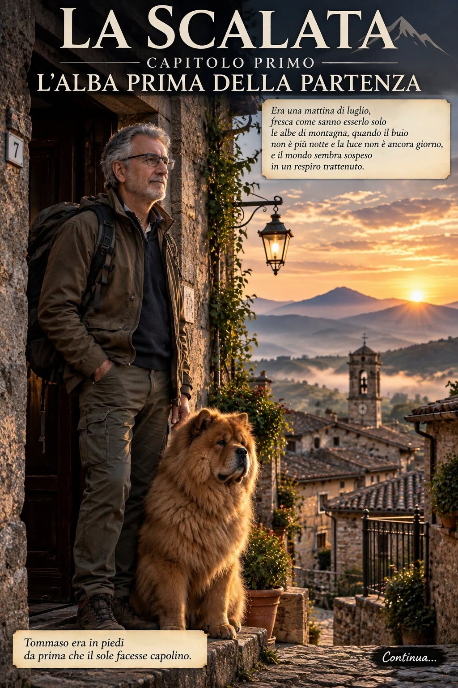
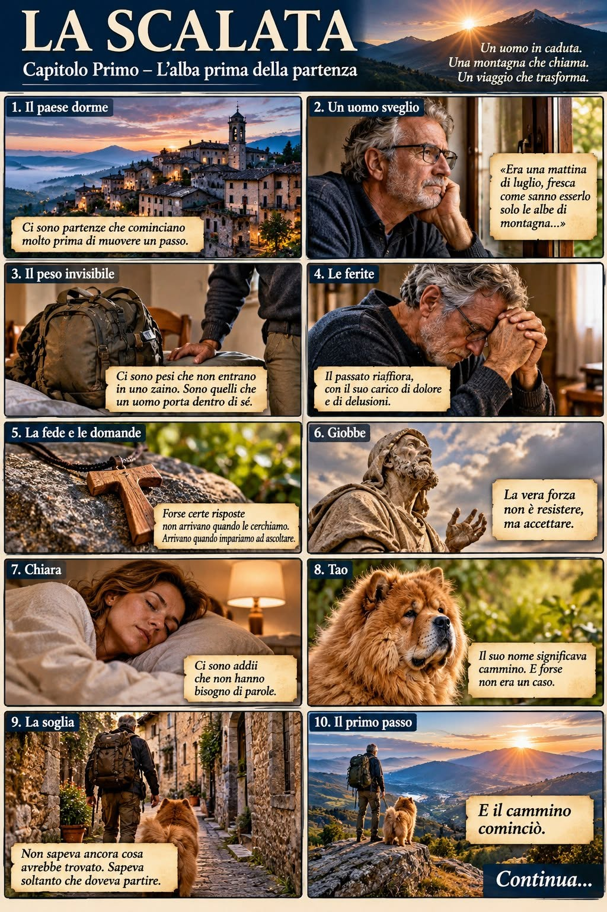
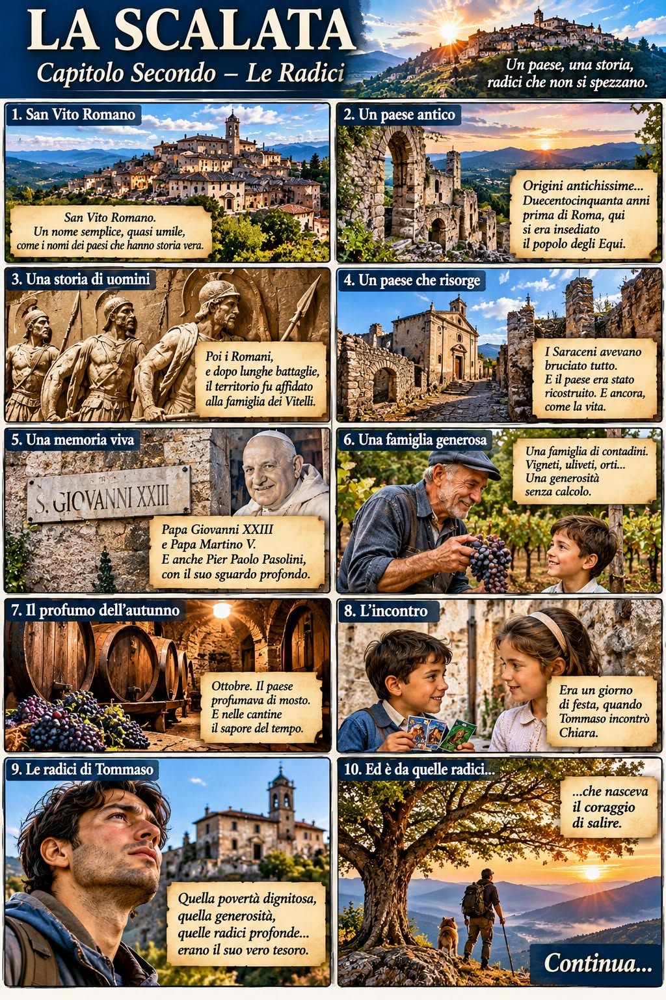

## Chapter One – The dawn before the departure

There are falls that seem to take everything away. And yet, sometimes, just when our certainties collapse, a new space opens up inside us.

Tommaso has known the weight of loss, the silence of disappointment and the loneliness of those who are judged without being understood.

But he does not feel finished.

Something is calling him. A mountain, a road still unknown, perhaps an answer he does not yet know he is looking for.

At his side is Tao, his faithful companion.

> “As if losing all his belongings had created a space. And into that space, at last, the air could come in.”

It is from that space that the departure is born.

Tommaso does not yet know what he will find. He only knows that the time has come to set out.

**The journey has only just begun.**

*To be continued…*

A novel by Vito Rossi\
A photo-novel in photorealistic panels
