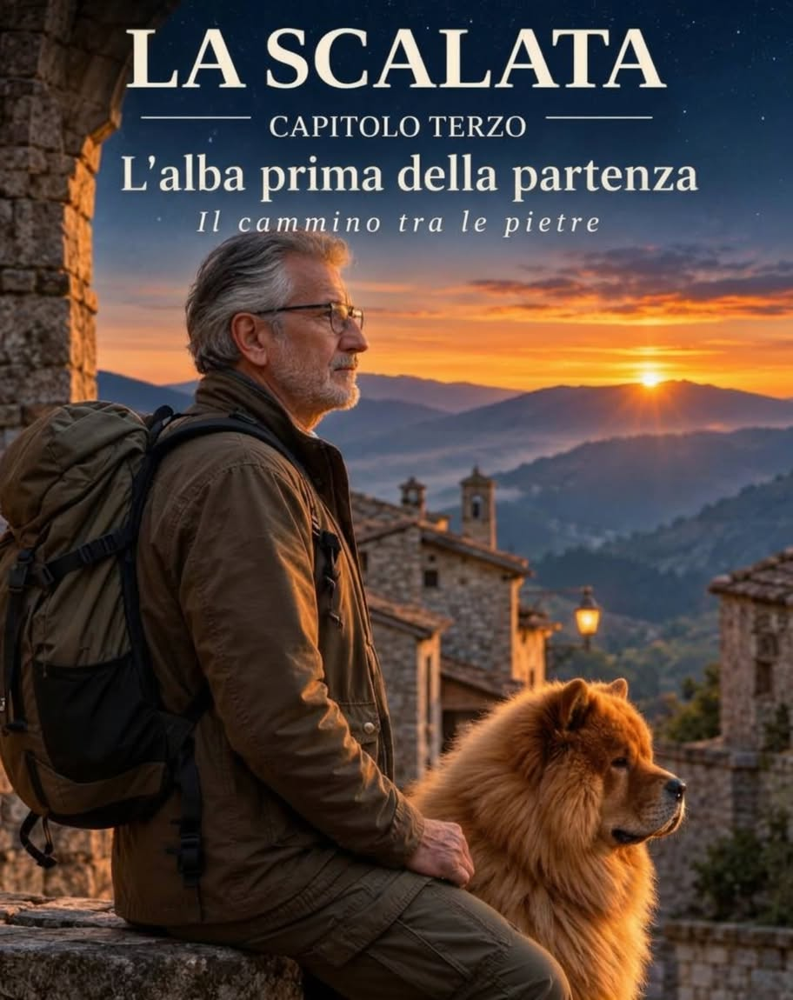

Tommaso leaves home before dawn with his dog Tao, heading for a mountain everyone calls sacred. But perhaps the summit is not where one thinks. Enjoy the read, and enjoy the walk.

## Chapter Three – The dawn before the departure

We left the house when it was barely three in the morning. I closed the door behind me with a moment of hesitation, like someone afraid of having forgotten something. Then I set off. [📷 Photo 1](#foto-1) [📷 Photo 2](#foto-2)

It had taken a long time to convince my wife Chiara, even though she was the person who, better than anyone else, could understand what I was about to do. She would take care of our little ones.

I left my old town, the steps, the squares, the smell of the ancient walls, neglected for some time despite its unrepeatable beauty. I walked in the dark of the early hours, and near a large stone basin in the old town, the only voice of that night about to turn into morning, my literature teacher came to mind. I had written in an essay that, in that place and at that hour close to dawn, the silence was loudly noisy, my steps echoed like silent music, sonorous solitude. She said it was too beautiful to be my own work. It wasn't entirely, but in those moments it truly was. [📷 Photo 3](#foto-3)

These are feelings that come from deep in the heart, or the mind, I couldn't say. They put you in touch with the sky and seem to loosen the bond with matter, reaching towards the ether. It is in these very moments that we realise the earth is our chain, and sense at the same time that it is also the field that sprouts, the umbilical cord of our spirit. Mother of our pain and of our love, mirror of our life.

With Tao at my side I felt calm and confident: so quiet, well-mannered, silent, and brave too. Perhaps in his puppy's memory he still kept Tea, the companion of his short life, who died of gastroenteritis. I called her: “Tea, how are you?”. She didn't answer. I opened the door to let fresh air into the room and she went out, lay down under the olive tree I had named Giuseppe, because I had planted it on 19 March together with my little ones, and stayed there staring at the moon, no longer whimpering. I could only cry, powerless before the pain of a creature so full of life until a few days before. [📷 Photo 4](#foto-4)

Tao had grown up by now, at least forty kilos, a fine coat, in excellent health. I felt ready for this journey full of uncertainties, in search of what the sacred mountain might hide. That's what they called it, so majestic and titanic it was. It had the shape of a pyramid and seemed not to belong to my lands. When the sun hid behind it, a large part of the land fell into darkness.

My ancestors said that few had seen what lay beyond, and no one had been able to describe it clearly. I am not a mountaineer: I am a self-employed professional who knows something about land measurements and accounts... A man like many others, who suffered a great deal before setting his mind on this unplanned journey, alone and by himself. [📷 Photo 5](#foto-5)

> I start from myself. Not to move away from myself, but to come closer to who I am.

The sun began to stand out on the horizon and, as soon as it peeped out, it shot its golden arrows. The dewdrops on the grass began to shine, silver, and little by little you could make out the summer blossoms of the trees and the fruit they bore or would bear. The dew, the weeping of the night, that quenches the thirst of small creatures for the day. The verses of Torquato Tasso came back to me: [📷 Photo 6](#foto-6) [📷 Photo 7](#foto-7)

> Qual rugiada o qual pianto,\
> quai lagrime eran quelle\
> che sparger vidi dal notturno manto\
> e dal candido volto de le stelle?\
> […]\
> Fur segni forse de la tua partita,\
> vita de la mia vita?

*(What dew or what weeping, what tears were those I saw scattered from the mantle of night and from the white face of the stars? […] Were they perhaps signs of your departure, life of my life?)*

The dew, that freezes, that draws spider webs, moods, feelings. Water vapour of the atmosphere. The dew that is good for plants, that gives them just the right moisture. It settles over my whole Valley, on the pearly olive trees, on the dandelions, weighs down the dandelion clocks, refreshes, and when it rises, wets your eyelashes. Its clear glimmer, like a blanket of soft cotton balls, covers the throbbing of the life beneath. [📷 Photo 8](#foto-8)

Dew that breathes in time, with the rhythm of the seasons, with the rhythm of a life that takes you away in a single breath. Drops of light, no two alike. How much world is there inside a single drop of dew?

Every now and then Tao wandered off and came straight back to my side, as if he went ahead to test the path. Who knows, perhaps he was the guide I had been waiting for on this climb.

I stopped for a moment on the path and held between my fingers the small wooden Tau I had been carrying with me for a long time. Not an amulet, but a sign of faith and salvation: the promise that no journey is made alone. [📷 Photo 9](#foto-9)

The wish to see what lay up there, on the sacred mountain, came from a distant day, when I had gone looking for mushrooms, those mysterious beings with a magical, sly look. In the forest at the foot of the mountain I got lost. I was alone, the sun was about to set and I had perhaps two hours of light left. I had found mushrooms, not many but beautiful: porcini joined in a single cluster, at least two kilos. True masterpieces of nature. Just one, the biggest, weighed two kilos and three hundred grams. [📷 Photo 10](#foto-10) [📷 Photo 11](#foto-11) [📷 Photo 12](#foto-12)

I thought, and felt, that I had left something of myself in that place.

**Tommaso and Tao have left the town. The mountain is still far away, and the porcini forest is waiting for them.** [📷 Photo 13](#foto-13)

*To be continued…*

A novel by Vito Rossi\
A photo-novel in photorealistic panels
