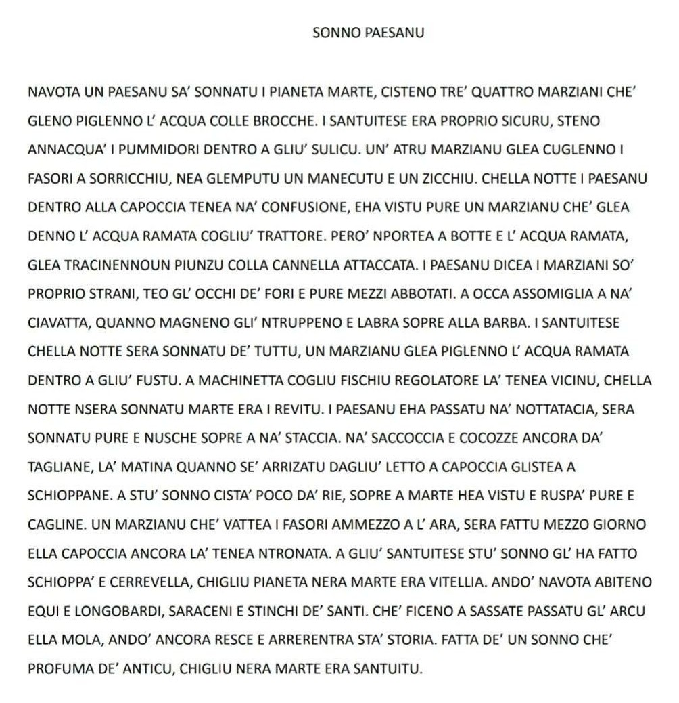

## The text in Sanvitese

## Explanation in English

The poem “Sonno paesanu” (A Villager’s Dream) tells of a man from San Vito who, one night, dreams he is on the planet Mars. But it is a very peculiar Mars: the Martians fetch water with jugs, water the tomatoes in the furrow, pick beans at Sorricchiu, spray copper water with the tractor and thresh beans on the threshing floor, just as people used to do in the village fields. They have bulging eyes and a comical look, and the dreamer watches them with the confusion of someone who no longer quite knows where he is.

In the morning, when he gets out of bed with his head fit to burst, he realises that the distant planet was none other than his own village: ancient Vitellia, where the Aequi and the Lombards once lived and the Saracens passed through, with the Arco della Mola and the stories that still resurface. With irony and affection, the author reminds us that the everyday village, with its work and its traditions, holds something extraordinary: a dream that smells of times gone by, in which Mars was San Vito.
