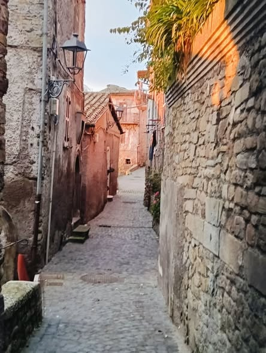

*An image that dispels all doubt, unites the centuries and answers, with the force of history, anyone who tries to empty our village.* 📜🏹

San Vito Lovers, take a look at this freeze-frame. It is no abstract reconstruction: it is a historical translation of the stone alley of [Via Arringo](/en/luoghi/via-dellarringo/), where some of us were born. I myself, co-creator of our Master Plan, was born and raised here. We chose to date this view symbolically to the 13th century, the golden age of the Free Communes, setting the date on a monumental stone plaque, within the image, that everyone will now be able to read and remember.

## Two worlds compared: history against stagnation

If we place today's photograph of our alley beside this meticulous photorealistic reconstruction of the past, imperfect as it may be, we understand the power of the message we are sending to the old politics and to the officials of the "macro scale".

- **The Arringo of the past (the image):** it shows a thriving street, a living and well-kept artery, trodden by merchants, craftsmen and citizens. This is the road people climbed from the lower acropolis to the great open space of the Arengo, to exercise direct democracy, approve the Statutes and defend the walls.
- **The lesson for the present (the Master Plan):** the detractors of progress use higher-level planning restrictions as bureaucratic excuses to freeze the village in the "cobwebs" of neglect. But this image reminds us that a place is protected by keeping it alive, not by abandoning it. Just as our ancestors came together in the Arengo, today our virtual square takes up that civic baton to plan the works of tomorrow: from the Reinforced Earth structures of the Pinetina to the water spine of the Parco dell'Acqua.

## Many fingers, one palm

Those who transcribe our history, those who analyse historical core samples and those who study the soil under the microscope know that we are not alone. The roots of San Vito Romano are anchored in this stone and in the courage of figures from history and enterprise, from the medieval ones to the pragmatic and unforgettable Michelina Mastrantonio, who always saw water and the land as a resource to be governed, never a bogeyman to be feared.

The plaque is clear, the images speak for themselves. Let us keep protecting our territories, offering them new possibilities and a future worthy of their great past.

Share this if this historical coincidence makes you proud to be one of the fingers of this splendid territorial hand! ❤️

\#SanVitoLovers \#ViaArringo \#SecoloXIII \#ArengoRitrovato \#IngegneriaNaturalistica \#LaStoriaTornaAVivere \#MontiPrenestini \#UnaManoSola

*The plaque and the 13th-century scene are a reconstruction created with artificial intelligence: the plaque does not exist in the real alley.*
