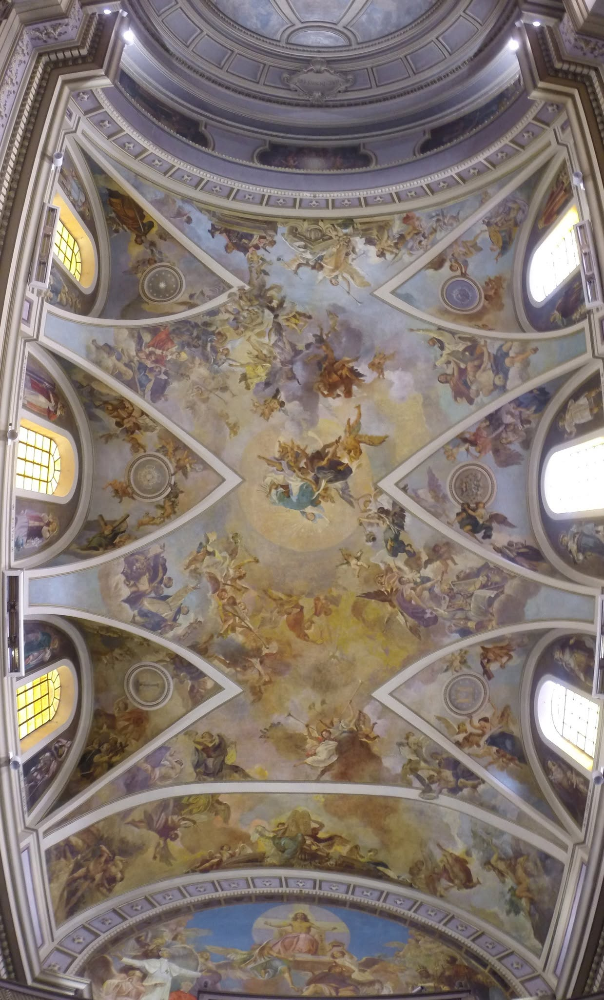

The restoration of the paintings on the vault of [Santa Maria de Arce](/en/luoghi/santa-maria-de-arce/) in San Vito Romano became a unique opportunity to rediscover the community's past. In mid-September 2015, in the presence of Bishop Domenico Sigalini, Guido Trinchieri's book on this historic recovery was presented: a work firmly grounded in archival documents, yet told with the gripping pace of a novel.

## Painstaking research between faith and history

The book was the fruit of years of passionate work, based on cross-checking documents held in the state archives, in the diocesan archive and in the precious material inherited from Don Guarino Nini, the long-serving parish priest from 1908 to 1943. Thanks to that meticulous investigation, the author managed to piece together the artistic and historical events of the last 450 years of the church and its faithful.

## From the drama of the fire to the original splendour

The story opens with a dramatic event: on 5 May 2003 lightning struck the church, starting a fire that badly blackened the vault. From that moment the book travels back in time, reconstructing the life of the church through pastoral visits, letters and period chronicles, which mirror the changing concerns of the San Vito community across the ages.

The final chapter was devoted to the complex restoration of the vault itself. The work, completed before Christmas 2014, gave back its original brilliance to the masterpiece painted by Aronne Del Vecchio in the 1940s.

## A living link with the past

The event, which I presented as director of the Diocesan Office for Cultural Heritage, was enriched by the presence of exceptional witnesses, who linked the present to the history of the building:

- the architect Giancarlo Busiri Vici, son of Michele, the designer who oversaw the enlargement of the church in the 1920s;
- Maria Antonietta Del Vecchio, only daughter of the painter Aronne and guardian of his artistic legacy.
