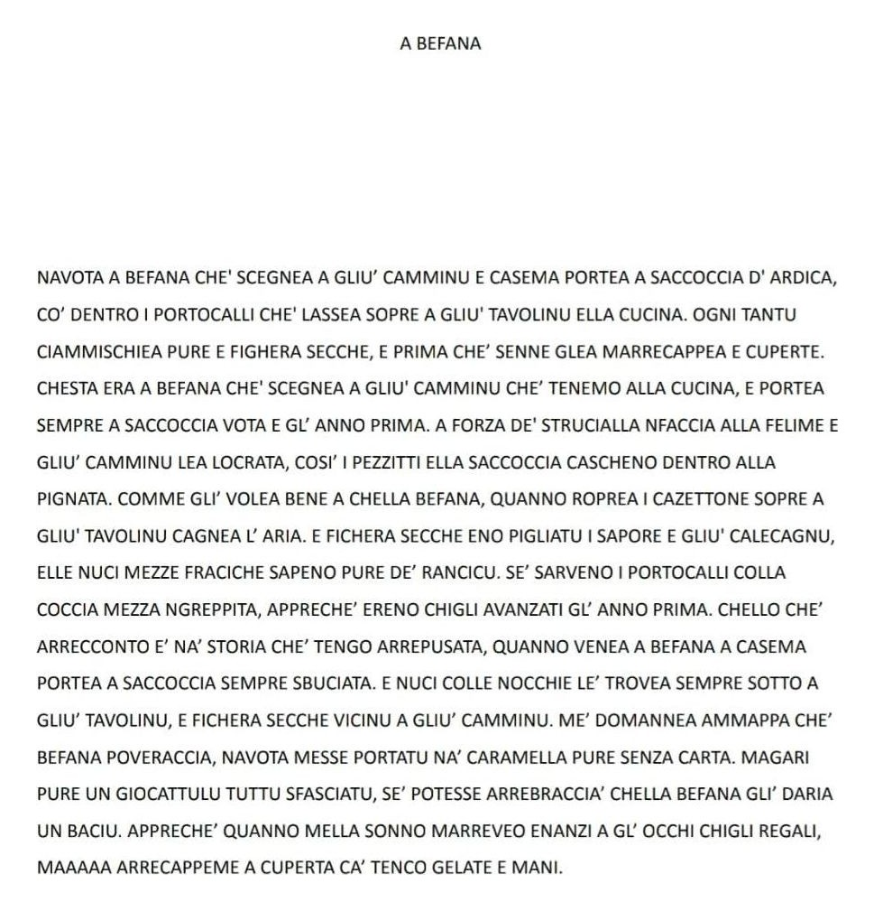

## Il testo in sanvitese

## Spiegazione in italiano

La poesia racconta, con nostalgia e ironia, i ricordi d'infanzia legati alla Befana, così come veniva vissuta una volta.

La Befana arrivava di notte, scendendo per il camino e lasciando nella calza, appesa vicino al focolare, qualche regalo semplice: arance, noci, fichi secchi e caramelle. Spesso, però, la frutta era vecchia, le noci un po' rancide e i fichi secchi avevano perso il loro sapore. A volte la calza era persino bucata e i pochi doni finivano nella pentola sottostante.

Eppure, quei piccoli regali erano attesi con grande emozione. Il ricordo della Befana è così vivo che l'autore racconta di sognarla ancora, immaginando di poterla riabbracciare e darle un bacio, come avrebbe voluto fare da bambino.

Ma il sogno si interrompe: si ritrova sotto le coperte, con le mani gelate.

Il significato più profondo è il rimpianto per un'infanzia povera di cose materiali, ma ricca di attese, fantasia e affetto. Anche se i doni erano modesti e spesso di scarsa qualità, la Befana rappresentava una magia speciale, rimasta nel cuore per tutta la vita.
