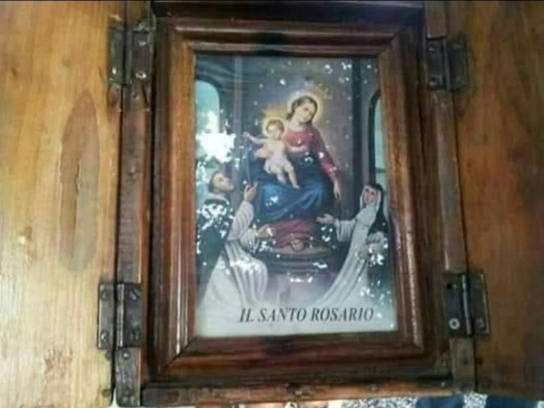

## Il testo in sanvitese

<figure class="didascalia">

A TECA ELLA MADONNA E GLIU’ ROSARIU

<pre>NAVOTA PE’ SANTUITU GIREA A’ TECA ELLA MADONNA E GLIU’ ROSARIU, QUANNO LA’ PORTENO A
MADREMA GIA’ EHA AFFATTATU I CAPU. APPENA L’ EHA PIGLIATA LA’ POGGEA SOPRE A GLIU’
TAVOLINU, GLEMPEA UN BICCHIERE E OGLIO EPPO’ APPICCEA I STOPPINU. CHELLA TECA TENEA I
SPORTEGLI COLLE BANNELLE, QUANNO MADREMA LA’ ROPREA ALLA MADONNA GLI’ BRILLENO E
STELLE. MANCHEA SULU CHE’ COMENZEA I ROSARIU, PADREMU STEA VICINU A GLIU’ CAMMINU E
GIA’ SERA ASSETTATU. MADREMA SERA FATTU I SIGNU ELLA CROCE, MENTRE NATRA PAESANA ERA
RENTRATA DENTRO A GLIU’ PORTONE. A TECA ELLA MADONNA CONOSCEA TUTTE E CASE E
SANTUITU, LA’ TENENO TRE’ GIORNI EPPO’ ARRECOMENZEA I GIRU. QUANTA DEVOZIONE TENENO
I PAESANI A CHELLA TECA GIRANTOLONA, QUANNO GLI’ TOCCHEA L’ ASPETTENO ALLA PORTA GIA’
COLLA CORONA. I BICCHIERE GLIU’ TENENO PREPARATU A UN ANGOLITTU, PIINU E OGLIO E GLIU’
STOPPINU RITTU. COMME E’ BELLA A TRADIZIONE ELLA MADONNA E GLIU’ ROSARIU, QUANNO
PASSA PELLE CASE E SANTUITU ABBUSSA PIANU PIANU. APPRECHE’ A DEVOZIONE COMENZA
DALLA MATINA, QUANNO A PAESANA SE’ SVEGLIATA E STA’ DENTRO ALLA CUCINA. COGLIU
MUCCOLOTTO PREPARATU, COMME SO’ BELLE CHELLE STELLE CHE’ LA’ MADONNA PORTA NCAPU.
A SANTUITU A FEDE ALLA MADONNA E GLIU’ ROSARIU E’ ANCORA VIVA, SCEGNE ABBALLE A
L’ ATTACECA EPPO’ ARREZZECCA NCIMA A SANTA MARIA. ATTRAVERSA TUTTU I BURGU COGLIU
MONTE E SANTUITU, ARRESCEGNE SOTTO A SAN BIAGIO PERO’ I GIRU NE’ FINITU. MANCA TUTTA
A GENTE CHE’ HA NCATRACCIATU I PORTUNI, CHELLA CHE’ HA MANNATU PURE I SCURRI. DENTRO
A CHELLE CASE NSE’ SENTE UN FIATU, SE’ CONSUMATU PURE I MUCCOLOTTO E GLIU’ STOPPINU
SE’ SMORZATU.</pre>

<figcaption>Il testo originale della poesia "A Teca ella Madonna e gliu’ Rosariu" in sanvitese, scritto da Antonio Orlandi.</figcaption>
</figure>

## Significato della Poesia

“A Teca ella Madonna e gliu’ Rosariu” racconta una tradizione di devozione che a San Vito si tramanda da generazioni: la teca della Madonna, una piccola cappella di legno con l'immagine della Vergine, che passa di casa in casa per la recita del rosario. Ogni famiglia la tiene tre giorni, poi la consegna ai vicini e il giro ricomincia.

L'autore ricorda quando arrivava a casa sua. La madre si era già preparata per accoglierla; appena la riceveva la poggiava sul tavolino, riempiva un bicchiere d'olio e accendeva lo stoppino, il lumino che restava acceso davanti all'immagine. La teca aveva gli sportelli ornati di nastrini, e quando la madre li apriva sulla Madonna brillavano le stelle. Mancava solo l'inizio del rosario: il padre era già seduto vicino al camino, la madre si faceva il segno della croce, e intanto un'altra paesana entrava dal portone per pregare insieme.

La teca conosceva tutte le case di San Vito, e i paesani avevano una grande devozione per quella “teca girandolona”: quando toccava a loro la aspettavano sulla porta già con la corona del rosario in mano, con il bicchiere pronto in un angolo, pieno d'olio e con lo stoppino dritto. La devozione cominciava fin dal mattino, quando la donna di casa si alzava ed era già in cucina con il moccolo di candela preparato, e la Madonna arrivava con le sue stelle intorno al capo.

A San Vito la fede nella Madonna e nel rosario è ancora viva: la teca scende giù all'Attaceca, risale in cima a [Santa Maria](/luoghi/santa-maria-de-arce/), attraversa tutto il borgo del Monte di San Vito e ridiscende sotto [San Biagio](/luoghi/piazza-san-biagio/). Ma il giro ormai è finito: manca tutta la gente che ha sprangato i portoni e ha chiuso anche gli scuri. In quelle case non si sente più un respiro, si è consumato il moccolo e lo stoppino si è spento. La poesia si chiude così, con l'immagine del lumino spento, sulla nostalgia per un paese che si è svuotato.

