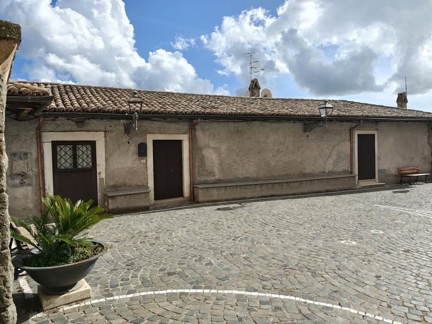
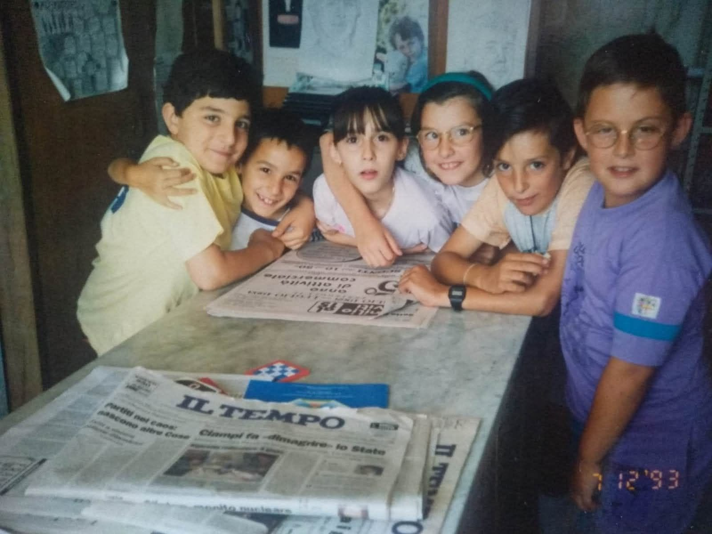
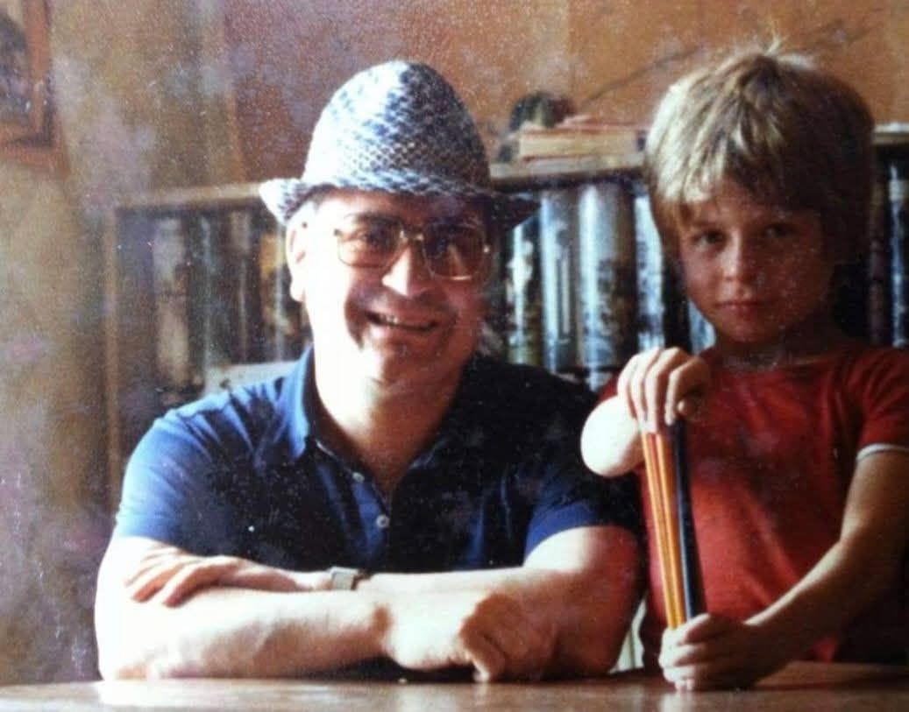

Per chi è cresciuto a San Vito Romano tra la fine degli anni Sessanta e la fine degli anni Novanta, dire "il prete di San Biagio" significava dire Don Marcello. Don Marcello Schiavella, originario della vicina Genazzano, arrivò alla parrocchia di San Biagio Martire nel 1968 e vi rimase per trent'anni, fino all'ottobre del 1998: un tempo lunghissimo, nel quale ha battezzato, sposato, accompagnato e soprattutto fatto crescere intere generazioni di sanvitesi. "Il mitico e ben voluto Don Marcello, simbolo di molte generazioni di giovani", come lo ha ricordato la community.

## La vocazione

La sua strada era cominciata prestissimo: entrò nel seminario di Palestrina nel 1948, ad appena undici anni, e proseguì poi gli studi al Pontificio Collegio Leoniano di Anagni. Chi lo ha conosciuto da giovane parroco lo ricorda con la veste, i folti capelli neri e gli immancabili occhiali dalla montatura importante; e con il breviario, che recitava puntualmente ogni pomeriggio, senza saltarne uno. C'è anche chi lo ha avuto come professore alle scuole medie.

## Le tre porte di Piazza San Biagio

Il suo mondo era [Piazza San Biagio](/luoghi/piazza-san-biagio/). Sotto la chiesa si aprono tre porte, che i sanvitesi ricordano bene: la prima era il deposito della bottega di Giuliano, la seconda la sala ricreativa, la terza lo studio di Don Marcello, con la biblioteca. Sul muro, per anni, una scritta richiamava tutti a "pace, lavoro e fratellanza"; è sparita quando, dopo la sua partenza, l'edificio è stato ristrutturato e ritinteggiato.

Nei locali della parrocchia si facevano il catechismo, le tombolate con tutti i ragazzi "nabballeri" del quartiere di nnabballe e soprattutto il cinema. Quasi tutte le domeniche Don Marcello proiettava un film: alla porta c'era Valeriano, con il suo banchetto, a strappare i biglietti, e con 100 lire ci si vedeva lo spettacolo, ragazzi, famiglie e anziani insieme. Per i più grandi, ancora oggi, quello resta "il mitico cinema di Don Marcello e Valeriano", una specie di "Nuovo Cinema Paradiso" sanvitese, e a tutti e due va ancora "un grazie per le bellissime domeniche insieme ai loro film".

Il suo studio, invece, era per molti "una tana piena di serenità, cultura e lavoro". Lì Don Marcello costruiva le sue opere in legno: diorami che riproducevano gli angoli più caratteristici di San Vito, precisi fino ai minimi particolari, che spiegava con gioia a chi andava a trovarlo. E con l'archetto da traforo insegnava a lavorare il legno anche ai ragazzi. Era appassionato di fotografia, e scattava foto in continuazione ai suoi ragazzi.

Giancarlo ricorda di aver trovato, tra gli scaffali di quella biblioteca, un bellissimo libro sugli scacchi: è grazie a quel libro che ha imparato a giocare. Sul tavolo dello studio, poi, c'erano sempre tutti i quotidiani: Don Marcello li metteva a disposizione di chiunque volesse leggerli. E proprio dai giornali amava ritagliare le barzellette più belle e le collezionava incollandole una a una in un suo libro. E come dimenticare il periodo in cui costruì, in miniatura e tutto in legno, il borgo antico di San Vito Romano. "Quanta pazienza che aveva."

Quel San Vito in miniatura si può ancora vedere in un breve video condiviso su Facebook: il paese ricostruito pezzo per pezzo, in legno, dalle sue mani.

<button type="button">▶ Guarda il video</button>

Il video viene caricato da Facebook, che può usare i propri cookie. In alternativa puoi <a href="https://www.facebook.com/reel/1674302923438014" target="_blank" rel="noopener noreferrer">aprirlo su Facebook</a>.

*San Vito Romano in miniatura, tutto in legno: una delle opere di Don Marcello.*

## Il prete dei ragazzi

"Un prete che ha rivoluzionato la parrocchia di San Biagio, creando un gruppo di giovani che ancora oggi sono molto uniti e grati sempre a lui, per il dono dell'amicizia, dell'unione, della fede": così lo descrive chi c'era. Don Marcello sapeva come trattare e intrattenere i ragazzi: organizzava campeggi, gite e scampagnate alla Sonnina, feste in piazza, pellegrinaggi. Per le processioni preparava costumi così belli che i ragazzi "facevano a botte" per indossarli. In tanti sono stati suoi chierichetti, e c'è chi ricorda di averlo aiutato, da ragazzo, a rifare il tetto della sagrestia, bagnando il cemento.

Con i ragazzi stringeva legami che sono durati una vita. Lo racconta una foto che lo ritrae, con il cappello estivo, accanto a un piccolo Giammarco che stringe un fascio di matite colorate: "legami indissolubili, oltre il tempo e lo spazio". Per qualcuno è stato "come un padre", per altri "un amico e un educatore" che ha accompagnato un periodo della vita, o una presenza capace di aiutare nei momenti più duri, come la perdita di una madre.

## La chiesa sempre piena

La chiesa, ai suoi tempi, era sempre piena. La domenica mattina diceva messa anche al santuario della Madonnina, e anche lì non restava un posto libero. Ha celebrato i matrimoni di tanti sanvitesi, a San Biagio come alla Madonnina, e per alcuni non ha esitato a spostarsi fino a Roma o a Nettuno pur di sposarli lui. Antonio Orlandi, nel suo sanvitese, ricorda così la piazza di quegli anni: "piazza san Biagio era tutta na' pipinara, cinquanta persone senteno e unu sonea a chitarra. Mentre don Marcello dicea a messa e giuliano i bottegante taglea a ventresca."

<button type="button">▶ Guarda il video</button>

Il video viene caricato da Facebook, che può usare i propri cookie. In alternativa puoi <a href="https://www.facebook.com/100026558231241/videos/pcb.1367185332278557/1555335985999011" target="_blank" rel="noopener noreferrer">aprirlo su Facebook</a>.

*Un video sulla chiesa di San Biagio Martire, che Don Marcello ha guidato per trent'anni.*

## La passione per il calcio

L'altra sua grande passione era lo sport, e il calcio in particolare. Don Marcello sostenne le squadre giovanili e fece dell'ambiente sportivo della parrocchia un luogo in cui crescere: proprio lì mosse i primi passi da calciatore Francesco Rocca, il terzino della Roma e della Nazionale soprannominato "Kawasaki" per la sua velocità.

Una delle immagini più care alla community lo ritrae a braccetto con due amici, Francesco e Antonello Mastropietro, in un prato d'estate: sotto il cappellino bianco, Don Marcello sorride tra i due giovani. Oggi nessuno dei tre è più tra noi, e chi ha voluto ricordarli insieme ha scritto: "Siete partiti, lasciandoci orfani delle vostre peculiarità, ma ricchi per sempre del vostro esempio e del bene che ci avete donato".

## Il ritorno a Genazzano

Nell'ottobre del 1998 Don Marcello lasciò San Vito Romano e tornò nella sua Genazzano, dove fu parroco della chiesa di San Paolo Apostolo; anche lì, nei locali della chiesa, le sue opere in legno erano in bella mostra. Molti sanvitesi ricordano ancora il dispiacere per quel trasferimento. A Genazzano il suo legame con lo sport e con i giovani non si è perso: in suo ricordo si corre la "Genazzano a Perdifiato – Memorial Don Marcello Schiavella", una corsa su strada di 9,5 chilometri con gare anche per i più piccoli, giunta nel 2024 all'ottava edizione.

## I ricordi della community

Ogni volta che una sua foto compare nel gruppo Facebook della community, i commenti si moltiplicano: "indimenticabile", "il nostro prete, mai dimenticato", "un esempio di sacerdote", "grande sacerdote, grande uomo e grande amico", "Don Marcello sempre nel cuore, anzi il cuore di San Vito". C'è chi si dice "cresciuta a pane e Don Marcello", e chi lo riassume così: "non era soltanto un sacerdote, era una presenza, un punto di riferimento. Univa, non divideva. Parlava poco e faceva molto". E anche chi in quegli anni non c'era riconosce in questi ricordi "una bellissima storia dove la semplicità la fa da padrone", e aggiunge: "È la nostra cultura e va protetta". In tanti si augurano che un giorno San Vito possa ricordarlo in modo stabile, e proprio a San Biagio, il luogo dove ha vissuto e dove ha dato tanto a ognuno.

*Fonte: ricordi condivisi dalla community su Facebook ([1](https://www.facebook.com/groups/sanvitoromano.lovers/posts/931444639185964/), [2](https://www.facebook.com/groups/sanvitoromano.lovers/posts/1367185332278557/), [3](https://www.facebook.com/groups/sanvitoromano.lovers/posts/1375874478076309/), [4](https://www.facebook.com/groups/sanvitoromano.lovers/posts/1395637989433291/), [5](https://www.facebook.com/groups/sanvitoromano.lovers/posts/1425343576462732/), [6](https://www.facebook.com/groups/sanvitoromano.lovers/posts/1439333888397034/), [7](https://www.facebook.com/groups/sanvitoromano.lovers/posts/1439644465032643/), [8](https://www.facebook.com/groups/sanvitoromano.lovers/posts/1439737121690044/)).*
