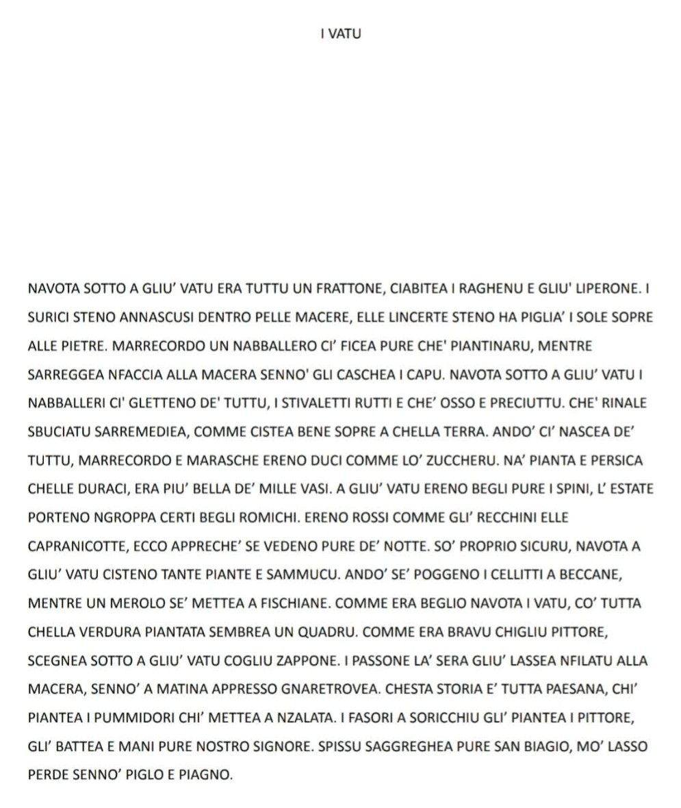

## Il testo in sanvitese

## Spiegazione in italiano

La poesia “I Vatu” ci accompagna in un viaggio nella campagna di un tempo, tra terreni incolti, pietre, cardi, rovi, fiori spontanei e frutti selvatici. Un paesaggio apparentemente disordinato, ma ricco di vita, colori e meraviglie, dove ogni pianta e ogni animale trovavano il proprio spazio. Sullo sfondo, il borgo di San Vito Romano domina le colline, mentre un contadino lavora la terra e si prende cura delle coltivazioni, in un legame profondo con la natura e con il ritmo delle stagioni.

Dalla fioritura primaverile al verde dell’estate, dai colori caldi dell’autunno al silenzio dell’inverno, riaffiora la memoria di un mondo semplice e autentico, fatto di lavoro, tradizioni e conoscenze tramandate di generazione in generazione. È il ricordo affettuoso di una campagna che non era soltanto terra da coltivare, ma parte dell’identità di una comunità, delle sue radici e della sua storia. Una bellezza da riscoprire, custodire e raccontare, proprio come ci insegna questa poesia in dialetto sanvitese.
