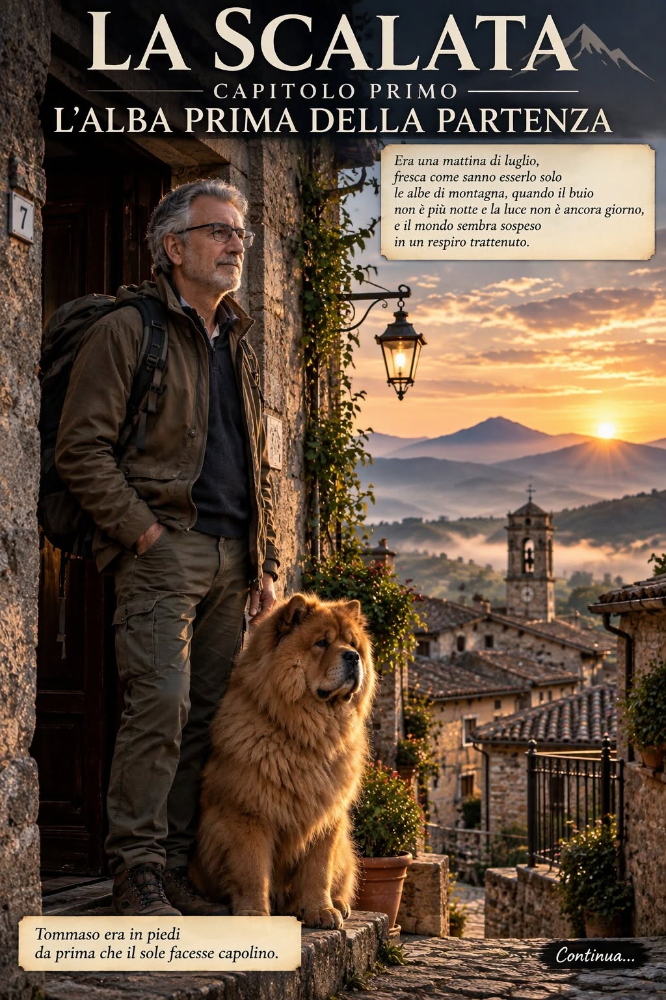
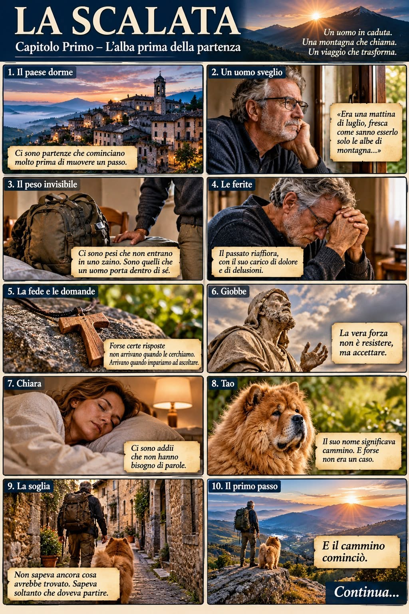

## Capitolo Primo – L'alba prima della partenza

Ci sono cadute che sembrano togliere tutto. Eppure, qualche volta, proprio quando le nostre certezze crollano, dentro di noi si apre uno spazio nuovo.

Tommaso ha conosciuto il peso della perdita, il silenzio delle delusioni e la solitudine di chi viene giudicato senza essere compreso.

Ma non si sente finito.

Qualcosa lo chiama. Una montagna, una strada ancora sconosciuta, forse una risposta che non sa ancora di cercare.

Al suo fianco c'è Tao, il suo fedele compagno.

> «Come se la perdita di tutto il materiale avesse creato uno spazio. E in quello spazio, finalmente, poteva entrare l'aria.»

È da quello spazio che nasce la partenza.

Tommaso non sa ancora cosa troverà. Sa soltanto che è arrivato il momento di mettersi in cammino.

**Il viaggio è appena cominciato.**

*Continua…*

Romanzo di Vito Rossi\
Fotoromanzo in vignette fotorealistiche
