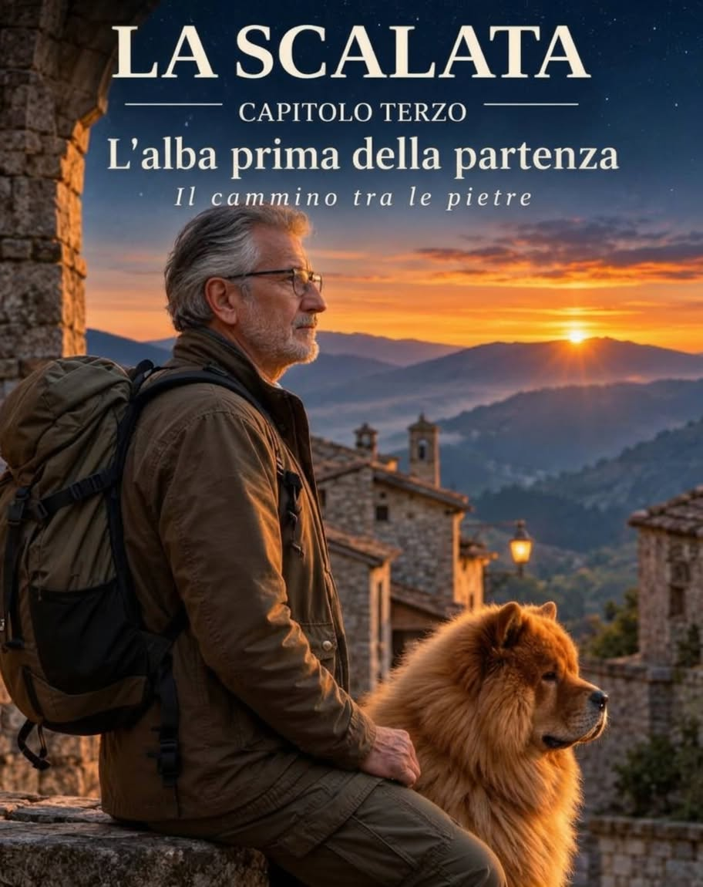

Tommaso lascia casa prima dell'alba, con il suo cane Tao, verso una montagna che tutti chiamano sacra. Ma forse la vetta non è dove si crede. Buona lettura, e buon cammino.

## Capitolo Terzo – L'alba prima della partenza

Uscimmo di casa che erano appena le tre del mattino. Lasciai la porta alle mie spalle con un attimo di esitazione, come chi teme di aver dimenticato qualcosa. Poi partii. [📷 Foto 1](#foto-1) [📷 Foto 2](#foto-2)

C'era voluto molto tempo per convincere mia moglie Chiara, anche se era la persona che meglio di ogni altra poteva capire ciò che stavo per fare. Ai nostri piccoli avrebbe pensato lei.

Lasciai il mio vecchio paese, le scale, le piazze, l'odore dei muri antichi, da un po' di tempo trascurato nonostante la sua irripetibile bellezza. Camminavo nel buio delle prime ore, e vicino a un vascone del paese vecchio, unica voce di quella notte che stava per farsi mattino, mi tornò in mente la mia insegnante di lettere. Avevo scritto in un tema che, in quel luogo e a quell'ora prossima all'aurora, il silenzio era fortemente rumoroso, i miei passi riecheggiavano come musica silenziosa, solitudine sonora. Lei disse che era troppo bello per essere farina del mio sacco. Non lo era fino in fondo, ma in quei momenti lo era eccome. [📷 Foto 3](#foto-3)

Sono sensazioni che partono dal profondo del cuore, o della mente, non saprei. Ti mettono in contatto con il cielo e sembrano sciogliere il legame con la materia, per tendere verso l'etere. Proprio in questi momenti ci accorgiamo che la terra è la nostra catena, e intuiamo al tempo stesso che è anche il campo che germina, il cordone ombelicale del nostro spirito. Madre del nostro male e del nostro amore, specchio della nostra vita.

Con Tao al fianco mi sentivo tranquillo e fiducioso: così calmo, educato, silenzioso, e anche coraggioso. Forse nella sua memoria di cucciolo conservava ancora Tea, la compagna della sua breve vita, morta di gastroenterite. La chiamai: «Tea, come stai?». Non rispose. Aprii la porta per cambiare l'aria della stanza e lei uscì, andò a mettersi sotto l'ulivo che avevo chiamato Giuseppe, perché l'avevo piantato il 19 marzo insieme ai miei piccoli, e restò a fissare la luna, senza più lamentarsi. Non potei che piangere, davanti all'impotenza di fronte al dolore di una creatura così piena di vita fino a pochi giorni prima. [📷 Foto 4](#foto-4)

Tao ormai era cresciuto, almeno quaranta chili, un bel pelo, in ottima salute. Io mi sentivo pronto per questo viaggio pieno di incertezze, alla ricerca di ciò che poteva nascondere la montagna sacra. Così la chiamavano, tanto era maestosa e titanica. Aveva la forma di una piramide e sembrava non appartenere alle mie terre. Quando il sole si nascondeva dietro di lei, una gran parte del territorio cadeva nel buio.

I miei antenati dicevano che pochi avevano visto cosa ci fosse al di là, e nessuno aveva saputo raccontarlo con chiarezza. Io non sono un alpinista: sono un libero professionista che conosce qualcosa di misure terrestri e di conti... Un uomo come tanti, che ha sofferto molto prima di mettersi in testa questo cammino senza previsioni, solo e da solo. [📷 Foto 5](#foto-5)

> Parto da me stesso. Non per allontanarmi da me, ma per avvicinarmici di più.

Il sole cominciò a stagliarsi all'orizzonte e, appena fece capolino, lanciò i suoi dardi dorati. Le gocce di rugiada sopra le erbe iniziarono a brillare, d'argento, e a poco a poco si scorgevano le fioriture estive degli alberi e i frutti che portavano o avrebbero portato. La rugiada, pianto della notte, che disseta le piccole creature per la giornata. Mi tornarono in mente i versi di Torquato Tasso: [📷 Foto 6](#foto-6) [📷 Foto 7](#foto-7)

> Qual rugiada o qual pianto,\
> quai lagrime eran quelle\
> che sparger vidi dal notturno manto\
> e dal candido volto de le stelle?\
> […]\
> Fur segni forse de la tua partita,\
> vita de la mia vita?

La rugiada, che si ghiaccia, che disegna ragnatele, umori, sensazioni. Vapore acqueo di atmosfera. La rugiada che fa bene alle piante, che dona loro il giusto senso di umidità. Si posa su tutta la mia Valle, sugli ulivi madreperlati, sui denti di leone, appesantisce i soffioni, rinfresca, e quando s'innalza, bagna le ciglia. Il suo chiaro luccichio, come una coperta di morbidi batuffoli, ricopre il palpitio della vita sottostante. [📷 Foto 8](#foto-8)

Rugiada che respiri a tempo, con il ritmo delle stagioni, con il ritmo della vita che in un soffio di fiato ti porta via. Gocce di luce, nessuna è uguale all'altra. Quanto mondo c'è dentro una sola goccia di rugiada?

Di tanto in tanto Tao si allontanava e subito tornava al mio fianco, come se andasse avanti a saggiare il percorso. Chissà che non fosse lui la guida che aspettavo per questa scalata.

Mi fermai un istante sul sentiero e strinsi tra le dita il piccolo Tau di legno che mi portavo dietro da tempo. Non un amuleto, ma un segno di fede e di salvezza: la promessa che nessun cammino si fa da soli. [📷 Foto 9](#foto-9)

Il desiderio di vedere cosa ci fosse in alto, sulla montagna sacra, nasceva da un giorno lontano, quando ero andato a cercare funghi, quegli esseri misteriosi dall'aspetto magico e furbesco. Nella foresta ai piedi della montagna mi smarrii. Ero solo, il sole stava per tramontare e mi restavano forse due ore di luce. Funghi ne avevo trovati, non molti ma bellissimi: porcini uniti in un unico ceppo, almeno due chili. Veri capolavori della natura. Uno solo, il più grande, pesava due chili e trecento grammi. [📷 Foto 10](#foto-10) [📷 Foto 11](#foto-11) [📷 Foto 12](#foto-12)

Pensavo, e sentivo, di aver lasciato in quel posto qualcosa di me.

**Tommaso e Tao hanno lasciato il paese. La montagna è ancora lontana, e il bosco dei porcini li aspetta.** [📷 Foto 13](#foto-13)

*Continua…*

Romanzo di Vito Rossi\
Fotoromanzo in vignette fotorealistiche
