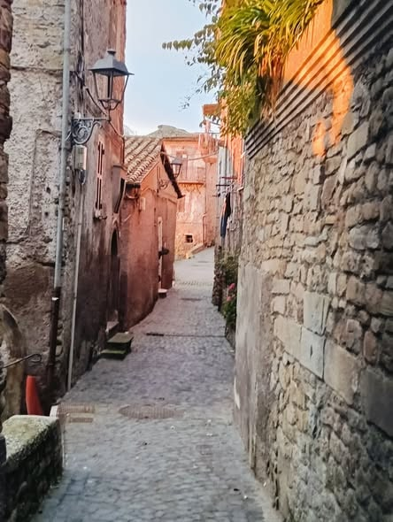

*Un'immagine che cancella i dubbi, unisce i secoli e risponde con la forza della storia a chiunque provi a svuotare il nostro borgo.* 📜🏹

San Vito Lovers, guardate questo fermo immagine. Non è una ricostruzione astratta: è la traduzione storica del vicolo in pietra di [Via Arringo](/luoghi/via-dellarringo/), in cui alcuni di noi sono nati. Io stesso, coideatore del nostro Master Plan, qui sono nato e cresciuto. Abbiamo voluto datare simbolicamente questo scorcio al Secolo XIII, l'epoca d'oro dei Liberi Comuni, fissando la data su una targa monumentale in pietra, nell'immagine, che d'ora in poi tutti potranno leggere e ricordare.

## I due mondi a confronto: la storia contro l'immobilismo

Se affianchiamo lo scatto contemporaneo del nostro vicolo a questa meticolosa ricostruzione fotorealistica del passato, pur se imperfetta, comprendiamo la potenza del messaggio che stiamo lanciando alla vecchia politica e ai funzionari della "macroscala".

- **L'Arringo del passato (l'immagine):** mostra una via pulsante, un'arteria viva e curata, calpestata da mercanti, artigiani e cittadini. È la strada percorsa per risalire dall'acropoli bassa fino al grande spiazzo dell'Arengo, per esercitare la democrazia diretta, approvare gli Statuti e difendere le mura.
- **La lezione per il presente (il Master Plan):** i detrattori del progresso usano i vincoli sovraordinati come scuse burocratiche per congelare il paese nelle "ragnatele" dell'incuria. Ma questa immagine ci ricorda che un territorio si tutela mantenendolo vivo, non abbandonandolo. Esattamente come i nostri antenati si univano nell'Arengo, oggi la nostra piazza virtuale raccoglie quel testimone civile per progettare le opere del domani: dalle Terre Armate della Pinetina fino alla spina idrica del Parco dell'Acqua.

## Tante le dita, uno solo il palmo

Chi trascrive la nostra storia, chi analizza i carotaggi storici e chi studia il suolo al microscopio sa che non siamo soli. Le radici di San Vito Romano sono ancorate a questa pietra e al coraggio di figure storiche e imprenditoriali, da quelle medievali fino alla pragmatica e indimenticabile Michelina Mastrantonio, che hanno sempre visto nell'acqua e nel territorio una risorsa da governare, mai uno spauracchio da temere.

La targa è chiara, le immagini parlano da sole. Continuiamo a tutelare i nostri territori, offrendo loro nuove possibilità e un futuro all'altezza del proprio grande passato.

Condividete se questa coincidenza storica vi rende fieri di far parte delle dita di questa splendida mano territoriale! ❤️

\#SanVitoLovers \#ViaArringo \#SecoloXIII \#ArengoRitrovato \#IngegneriaNaturalistica \#LaStoriaTornaAVivere \#MontiPrenestini \#UnaManoSola

*La targa e la scena del Secolo XIII sono una ricostruzione creata con l'intelligenza artificiale: la targa non esiste nel vicolo reale.*
