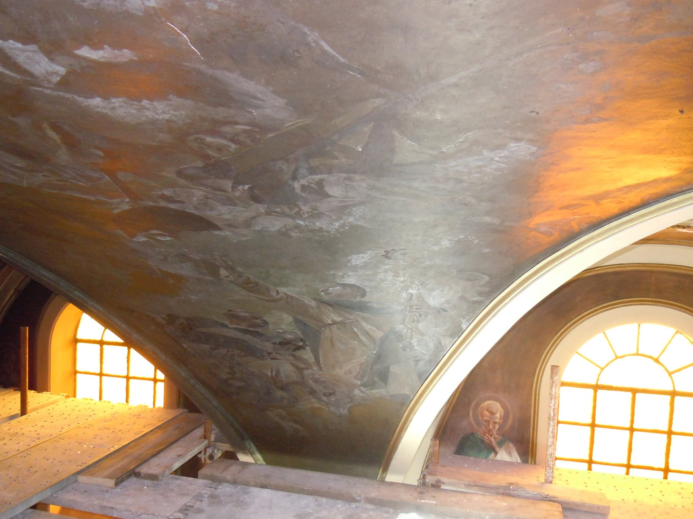
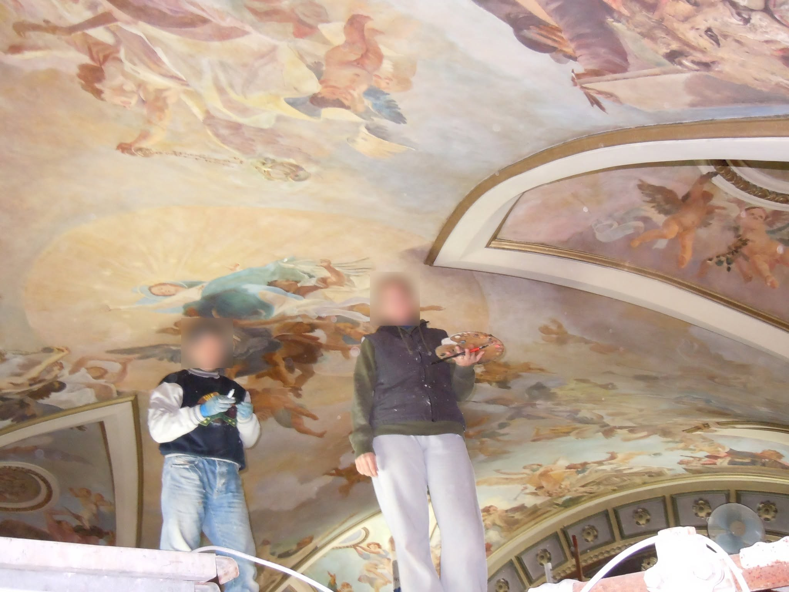

Il restauro dei dipinti della volta di [Santa Maria de Arce](/luoghi/santa-maria-de-arce/) a San Vito Romano si trasformò in un'occasione unica per riscoprire il passato della comunità. A metà settembre del 2015, alla presenza del Vescovo Mons. Domenico Sigalini, fu presentato il libro di Guido Trinchieri dedicato a questo storico recupero: un'opera che, pur fondandosi su rigorosi documenti d'archivio, si sviluppava con il ritmo avvincente di un romanzo.

## Una ricerca certosina tra fede e storia

Il volume fu il frutto di anni di appassionato lavoro, basato sull'esame incrociato di documenti custoditi negli archivi statali, in quello diocesano e nel prezioso materiale che era stato ereditato da Don Guarino Nini, storico parroco dal 1908 al 1943. Grazie a quella indagine minuziosa, l'autore riuscì a ricomporre le vicende storico-artistiche degli ultimi 450 anni della chiesa e dei suoi fedeli.

## Dal dramma dell'incendio allo splendore originario

Il racconto prende il via da un evento drammatico: il 5 maggio 2003 un fulmine colpì la chiesa, scatenando un incendio che ne annerì pesantemente la volta. Da quel momento, il libro viaggia a ritroso nel tempo, ricostruendo la vita dell'edificio sacro attraverso visite pastorali, lettere e cronache d'epoca, specchio delle alterne preoccupazioni che la comunità sanvitese aveva attraversato nelle varie epoche.

Il capitolo conclusivo fu dedicato proprio al complesso restauro della volta. I lavori, che erano stati ultimati prima del Natale 2014, restituirono la lucentezza originaria al capolavoro che il pittore Aronne Del Vecchio aveva realizzato negli anni '40.

## Un legame vivo con il passato

L'incontro, che presentai quale direttore dell'ufficio beni culturali della diocesi, fu arricchito dalla presenza di testimoni d'eccezione, i quali legavano il presente alla storia della struttura:

- l'architetto Giancarlo Busiri Vici, figlio di Michele, il progettista che aveva curato l'ampliamento della chiesa negli anni '20;
- la signora Maria Antonietta Del Vecchio, figlia unica del pittore Aronne e custode della sua eredità artistica.
