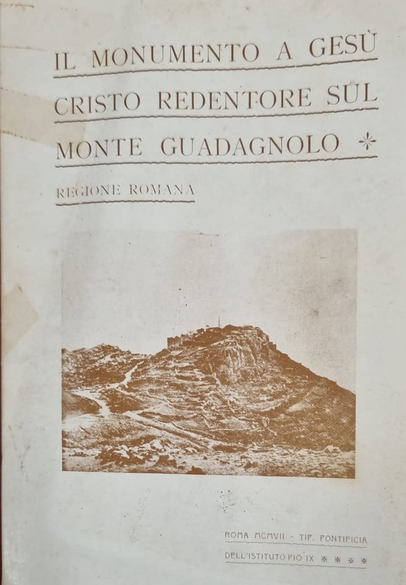
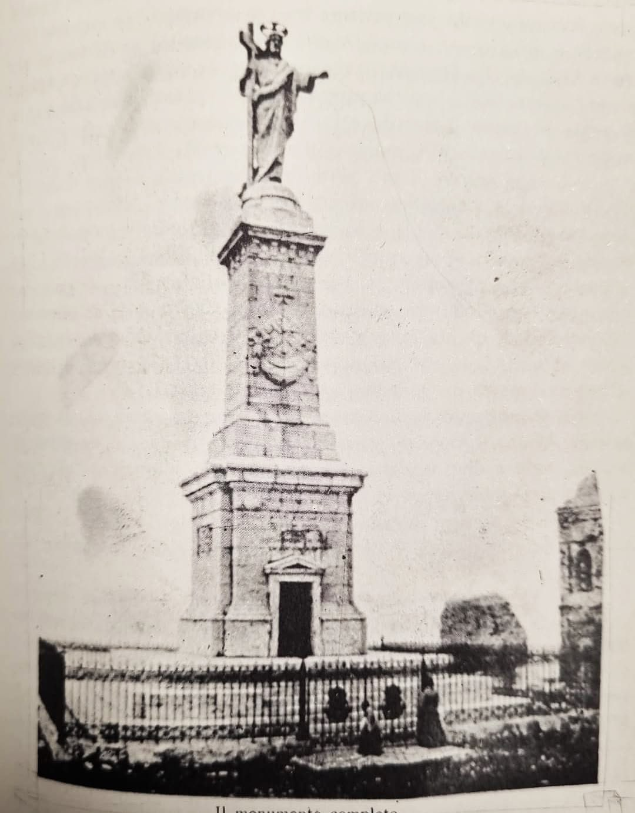

Guadagnolo, a hamlet of the municipality of Capranica Prenestina not far from San Vito Romano, sits atop the mountain of the same name at 1218 metres above sea level: it is the highest inhabited place in Lazio, perched on the tallest peak of the Prenestini Mountains. Despite having just 56 residents, this tiny mountain village offers one of the most extraordinary panoramas in the region.

From the summit the view sweeps 360 degrees over much of the central Apennines: the Alban Hills, the Affilani Mountains, the Simbruini Mountains and the Lucretili Mountains are all visible, and on the clearest days even the mountains of the Rieti area and the Lepini range can be made out. On summer evenings, at sunset, the view over Rome and the surrounding countryside below offers one of the most striking sights of the whole Prenestini area.

The mountain is the destination of numerous panoramic trails setting off from the surrounding villages, including the famous "Sentiero Wojtyla", dedicated to Pope John Paul II, which runs from Pisoniano up to the Sanctuary of Mentorella - the Polish pope was known to retreat here in prayer. The ridge path connecting the peaks offers breathtaking views over the Aniene and Sacco valleys, with the snow-capped profiles of the Simbruini, Lepini and Ernici mountains as a backdrop in winter.

Still today Guadagnolo, with its remote position and its skyline dominating the Prenestini range, remains a favourite destination for hikers and mountain lovers seeking genuine panoramas just a short distance from the capital.

## The first monument to Jesus Christ the Redeemer on Monte Guadagnolo

*On the stones of time: walking through the history of the Prenestini Mountains. A contribution by Agapito Fornari.*

Not long ago, at my mother's house, among the many books "buried" by time, I found the volume *Il monumento a Gesù Cristo Redentore sul Monte Guadagnolo - Regione Romana* (The monument to Jesus Christ the Redeemer on Monte Guadagnolo - Roman Region). It is a historical publication printed in 1907 by the Pontifical Press of the Istituto Pio IX in Rome, edited by the Central Roman Committee of the twenty monuments. Yellowed, marked by time, with a few loose pages, but still able to make me curious as I read it.

So I would like to share with you some images taken from the book and a little of the story it tells (back then it was the news of the day). The book documents how the majestic monument on Monte Guadagnolo came to be built for the Jubilee of 1900, when Pope Leo XIII wanted to celebrate twenty centuries of the Christian era with twenty monuments dedicated to Christ the Redeemer on the peaks of Italy. Committees were set up all over Italy to carry out the Holy Father's wish.

The foundation stone was laid on 30 September 1901, in the presence of the Bishop of Tivoli and many pilgrims. The works ended in May 1903 and the monument was inaugurated on 13 September 1903: the complex included a chapel at the base and a tall pillar supporting a statue of the Redeemer, with the right hand raised to bless Rome and the left holding the cross. The ceremony drew thousands of faithful.

The original monument was imposing, with an overall height of more than 23 metres (the statue of the Redeemer alone was over 5 metres tall). Above the architrave of the entrance chapel was a famous Latin inscription dedicated to the peoples of Lazio (Romans, Latins, Sabines, Aequi, Hernici, Volsci).

In the following years, in particular in 1921 and 1936, the structure was badly damaged by repeated lightning strikes, which caused its gradual ruin until it was finally demolished and replaced, in the 1970s, by the present bronze statue.

For this last statue, in the mid-1970s, I accompanied the then Bishop of Palestrina to the De Paolis film studios on Via Tiburtina for the blessing ceremony of the new statue of Christ the Redeemer, celebrated by Cardinal Luigi Traglia, then Dean of the College of Cardinals. The new bronze sculpture was made by the esteemed Tivoli artist and sculptor Elverio Veroli.

In 1976 Cardinal Luigi Traglia was at the height of his ecclesiastical prestige as Dean of the College of Cardinals. A native of nearby Albano Laziale and closely tied to the suburbicarian territory and the Roman province, he lent his authority to the inauguration and solemn blessing of the new protective symbol of the Roman countryside, just a year before his death at the end of 1977.

The surviving head of the original stone statue struck by lightning was not lost: it was recovered by the local people and should still be kept inside the modern church of San Giacomo Apostolo, right in the small square where you arrive in Guadagnolo.

*Photos from the book: Agapito Fornari. The present bronze monument is in the gallery at the bottom of the page.*

## Opening hours

Guadagnolo is a village and a mountain summit: the village, the viewpoint and the trails are in the open air and have no visiting hours. In winter, with snow or ice, it is best to check the road conditions before driving up.

The only place nearby with opening hours is the [Sanctuary of the Mentorella](/en/luoghi/santuario-della-mentorella), just below the summit: it is open every day from 8:00 am to 7:00 pm. Mass times and contacts are on the sanctuary page.

*Source for the sanctuary's opening hours: [Santuario della Mentorella](https://santuariodellamentorella.jimdofree.com/) (checked in October 2026).*

*Photo: LPLT, [Wikimedia Commons](https://commons.wikimedia.org/wiki/Category:Monte_Guadagnolo), CC BY-SA 3.0; Registrato2013, public domain; Sofiasettembre, CC BY-SA 4.0.*
