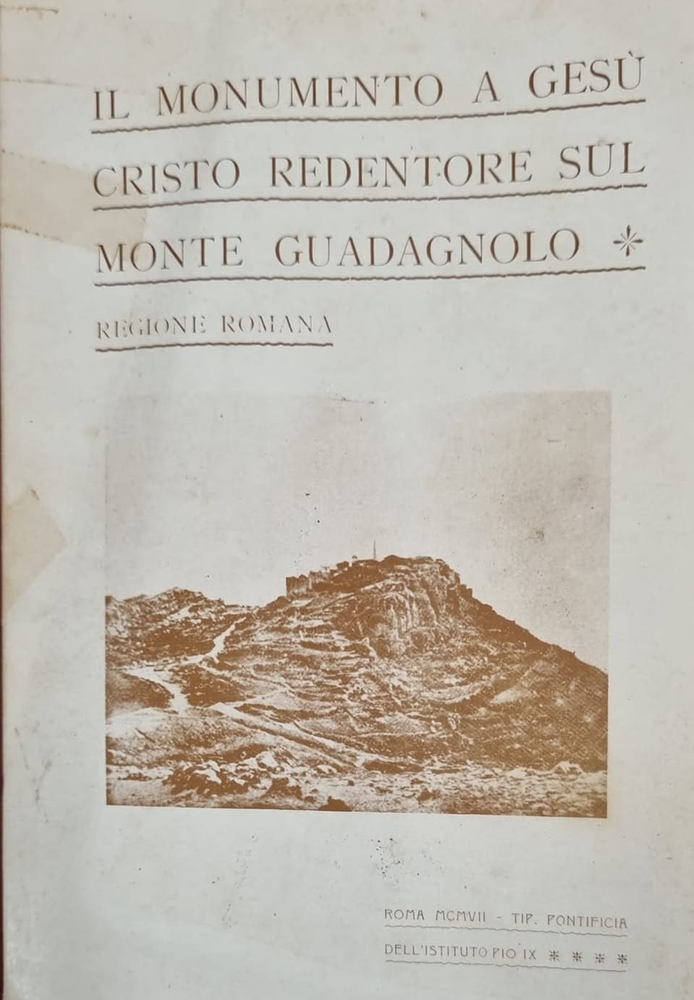
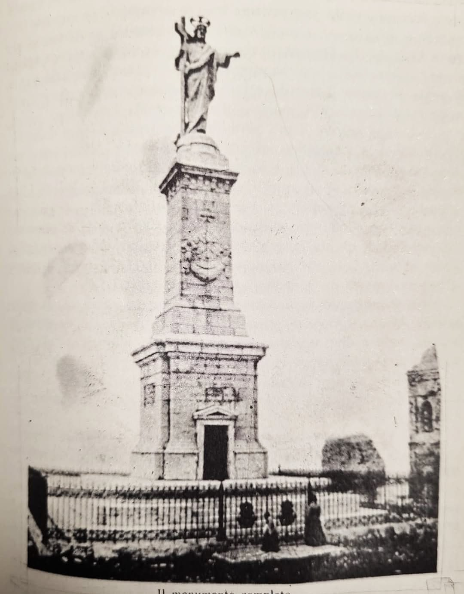

Guadagnolo, frazione del comune di Capranica Prenestina non lontano da San Vito Romano, sorge in cima all'omonimo Monte Guadagnolo a 1218 metri di altitudine: è il centro abitato più alto del Lazio, arroccato sulla vetta più elevata dei Monti Prenestini. Nonostante i soli 56 abitanti, questo minuscolo borgo di montagna offre uno dei panorami più straordinari della regione.

Dalla cima lo sguardo spazia a 360 gradi su gran parte dell'Appennino centrale: si distinguono i Colli Albani, i Monti Affilani, i Monti Simbruini, i Monti Lucretili e, nelle giornate più limpide, persino le montagne del reatino e i Monti Lepini. Nelle sere d'estate, al tramonto, la vista su Roma e sulla campagna romana sottostante regala uno degli spettacoli più suggestivi di tutta l'area dei Prenestini.

Il monte è meta di numerosi sentieri panoramici che partono dai paesi vicini, tra cui il celebre "Sentiero Wojtyla", dedicato a san Giovanni Paolo II, che da Pisoniano conduce fino al Santuario della Mentorella - il papa polacco amava infatti ritirarsi in preghiera in questo luogo. Il percorso di cresta che collega le vette regala scorci mozzafiato sulle valli dell'Aniene e del Sacco, con i profili innevati d'inverno dei Simbruini, dei Lepini e degli Ernici a fare da sfondo.

Ancora oggi Guadagnolo, con la sua posizione remota e il suo skyline che domina i Prenestini, resta una meta privilegiata per escursionisti e amanti della montagna in cerca di panorami autentici, a due passi dalla capitale.

## Il primo monumento a Gesù Cristo Redentore sul Monte Guadagnolo

*Sulle pietre del tempo: camminando nella storia dei Monti Prenestini. Un contributo di Agapito Fornari.*

Ho trovato poco tempo fa a casa di mia madre, tra i tanti libri "sepolti" dal tempo, il volume *Il monumento a Gesù Cristo Redentore sul Monte Guadagnolo - Regione Romana*. È una pubblicazione storica edita nel 1907 dalla Tipografia pontificia dell'Istituto Pio IX a Roma, a cura del Comitato centrale romano dei venti monumenti. Ingiallito, con i segni del tempo, con alcune pagine staccate, ma ancora in grado di incuriosirmi nella lettura.

Così voglio condividere con voi alcune immagini tratte dal libro e un po' della storia (allora era cronaca) raccontata. Il libro documenta la vicenda della realizzazione del maestoso monumento eretto sul Monte Guadagnolo in occasione del Giubileo del 1900, voluto da papa Leone XIII per celebrare i venti secoli dell'era cristiana con venti monumenti dedicati a Cristo Redentore sulle vette d'Italia. Appositi comitati si crearono in tutta Italia per portare a compimento la volontà del Santo Padre.

La posa della prima pietra avvenne il 30 settembre 1901, alla presenza del vescovo di Tivoli e di numerosi pellegrini. I lavori terminarono nel maggio del 1903 e il monumento fu inaugurato il 13 settembre 1903: il complesso comprendeva una cappella alla base e un alto pilastro che sosteneva una statua del Redentore, con la mano destra rivolta a benedire Roma e la sinistra a reggere la croce. La manifestazione richiamò migliaia di fedeli.

Il monumento originario era imponente, con un'altezza complessiva di oltre 23 metri (la sola statua del Redentore superava i 5 metri). Sopra l'architrave della cappella d'ingresso era posta una celebre iscrizione latina dedicata ai popoli del Lazio (Romani, Latini, Sabini, Equi, Ernici, Volsci).

Negli anni successivi, in particolare nel 1921 e nel 1936, la struttura subì gravi danni a causa dei ripetuti fulmini, che ne causarono la progressiva rovina fino alla definitiva demolizione e alla sostituzione, negli anni '70, con l'attuale statua in bronzo.

Per quest'ultima statua, a metà degli anni '70, accompagnai negli studi cinematografici De Paolis, in via Tiburtina, l'allora vescovo di Palestrina alla cerimonia di benedizione della nuova statua del Cristo Redentore, officiata dal cardinale Luigi Traglia, allora decano del Collegio cardinalizio. La nuova scultura bronzea fu realizzata dallo stimato artista e scultore tiburtino Elverio Veroli.

Nel 1976 il cardinale Luigi Traglia si trovava all'apice del suo prestigio ecclesiastico come decano del Collegio cardinalizio. Originario della vicina Albano Laziale e intimamente legato al territorio suburbicario e alla provincia romana, presenziò con la sua figura autorevole all'inaugurazione e alla benedizione solenne del nuovo simbolo protettivo della campagna romana, appena un anno prima della sua morte, avvenuta alla fine del 1977.

La testa superstite dell'originaria statua di pietra colpita dai fulmini non andò perduta: venne recuperata dalla popolazione locale e dovrebbe essere tuttora custodita all'interno della moderna chiesa di San Giacomo Apostolo, situata proprio nella piazzetta di arrivo a Guadagnolo.

*Foto del libro: Agapito Fornari. L'attuale monumento in bronzo è nella galleria in fondo alla pagina.*

## Orari

Guadagnolo è un borgo e una cima di montagna: il paese, il belvedere e i sentieri sono all'aperto e non hanno orari di visita. D'inverno, con neve o ghiaccio, conviene informarsi sulle condizioni della strada prima di salire.

L'unico luogo con un orario nei dintorni è il [Santuario della Mentorella](/luoghi/santuario-della-mentorella), poco sotto la cima: è aperto tutti i giorni dalle 8:00 alle 19:00. Messe e contatti sono nella scheda del santuario.

*Fonte per l'orario del santuario: [Santuario della Mentorella](https://santuariodellamentorella.jimdofree.com/) (consultato a ottobre 2026).*

*Foto: LPLT, [Wikimedia Commons](https://commons.wikimedia.org/wiki/Category:Monte_Guadagnolo), CC BY-SA 3.0; Registrato2013, dominio pubblico; Sofiasettembre, CC BY-SA 4.0.*
